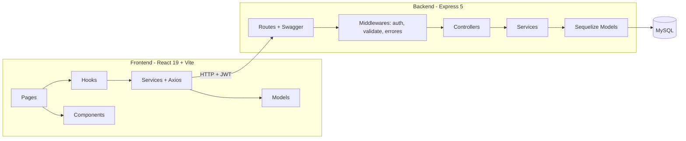
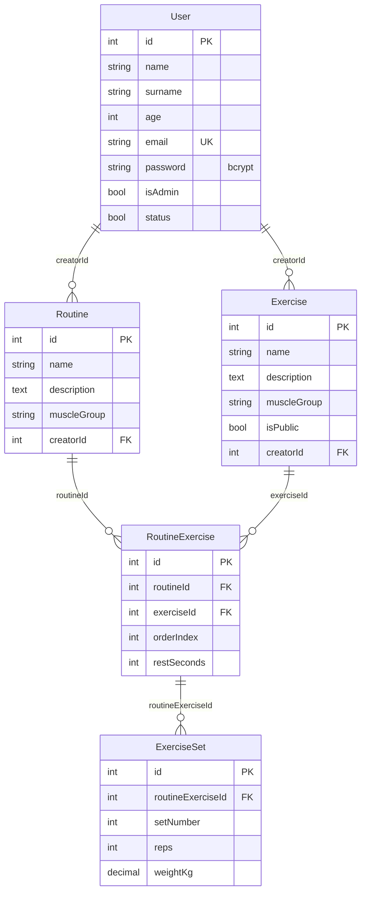

# Arquitectura

Aplicación full stack en un monorepo (`npm workspaces`) con dos partes **agnósticas entre sí** que se comunican solo mediante una API REST con JSON:

## Backend (`backend/`)

| Capa | Carpeta | Responsabilidad |
|---|---|---|
| Rutas | `routes/` | Define endpoints, middlewares y documentación OpenAPI (JSDoc) |
| Middlewares | `middlewares/` | `authenticate` (JWT), `requireAdmin` (nivel de acceso), `validateBody`/`validateId`, manejo central de errores |
| Validadores | `validators/` | Esquemas Yup de entrada |
| Controladores | `controllers/` | Traducen HTTP ↔ servicios (sin lógica de negocio) |
| Servicios | `services/` | Reglas de negocio y permisos (`UserService`, `ExerciseService`, `RoutineService`) |
| Modelos | `models/` | Sequelize (ORM) + asociaciones |
| Config | `config/` | Conexión a MySQL (`db.js`), Swagger, `sequelize-cli` |
| Utilidades | `utils/` | `ApiError`, hash de contraseñas (bcrypt), JWT |

- **Entradas**: `app.js` exporta la app Express (la usan los tests) y `server.js` hace `sync` y `listen`.
- **Errores**: toda respuesta de error tiene la forma `{ "mensaje": "...", "errores": ["..."] }` con códigos 400/401/403/404/409/500.
- **Ambientes**: variables en `.env` (ver `backend/.env.example`); en tests se usa SQLite en memoria (`NODE_ENV=test`).

### Autenticación y niveles de acceso

1. `POST /api/user/login` valida email y contraseña (bcrypt) y devuelve un **JWT** (`8h`).
2. El frontend envía `Authorization: Bearer <token>` en cada request (interceptor de Axios).
3. `authenticate` valida el token **y consulta la BD**: si el usuario fue eliminado o desactivado, el token deja de servir al instante.
4. Dos niveles: **usuario** (`isAdmin=false`) y **admin** (`isAdmin=true`).

| Recurso | Anónimo | Usuario | Admin |
|---|:-:|:-:|:-:|
| Registro / login | ✅ | ✅ | ✅ |
| Rutinas y ejercicios (lectura) | ❌ | ✅ | ✅ |
| Crear rutina / ejercicio privado | ❌ | ✅ | ✅ (el ejercicio es global) |
| Editar o borrar rutinas | ❌ | ✅ (solo propias) | ✅ (cualquiera) |
| Editar o borrar ejercicios privados | ❌ | ✅ (solo propios) | ✅ (solo propios) |
| Editar o borrar ejercicios globales | ❌ | ❌ | ✅ |
| Listar, activar/desactivar y eliminar usuarios | ❌ | ❌ | ✅ |

El rol nunca se toma del body: `isAdmin` solo puede asignarse en la base de datos.

## Frontend (`frontend/src/`)

| Carpeta | Contenido |
|---|---|
| `pages/` | Pantallas (Home/login, CreateUser, Routines, Exercises, Admin) |
| `components/` | Componentes reutilizables (props de entrada y callbacks de salida) |
| `hooks/` | Lógica de estado de cada pantalla (`useRoutines`, `useExercises`, ...) |
| `services/` | **Capa de servicios**: instancia única de Axios (`api.js`) con interceptores JWT/401 y un servicio por recurso |
| `models/` | **Modelos de datos** como clases (`User`, `Exercise`, `Routine`, `RoutineExercise`, `ExerciseSet`) con `fromApi()` |
| `constants/` | Etiquetas de grupos musculares y opciones de orden |

- **Rutas protegidas** (`App.jsx`): sin sesión se redirige al login; `/admin/users` solo es accesible para admin. Si el backend responde 401 se cierra la sesión automáticamente.
- **Configuración**: la URL de la API se define con `VITE_API_URL` (ver `frontend/.env.example`).
- **Estilos**: Bootstrap 5 + CSS por componente escrito **mobile-first** (`min-width`) con breakpoints SM 576 px, MD 768 px y LG 992 px.
- **Patrones**: custom hooks (separación lógica/UI), capa de servicios (facade sobre HTTP) y modelos con factory (`fromApi`).

## Modelo de datos

