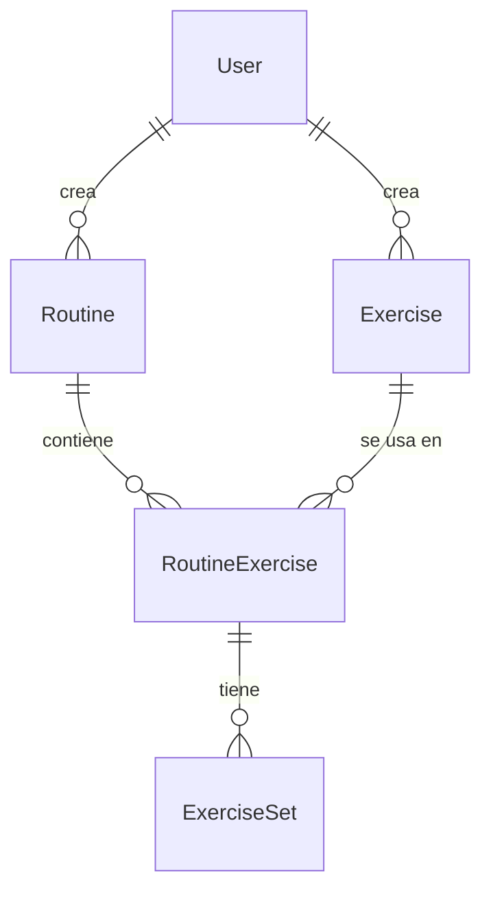

# Propuesta TP DSW — GymRoutines

## Grupo
### Integrantes
* _(legajo 54816)_ - Perroud, Juan Ignacio
* _(legajo 54810)_ - Bruzzesi, Juan José

### Repositorios
* Monorepo fullstack (frontend + backend): <https://github.com/JuanPerroud/tpDSW>

## Tema
### Descripción
GymRoutines es una aplicación web para crear y gestionar rutinas de gimnasio. Los usuarios arman su catálogo de ejercicios, diseñan rutinas con series, repeticiones, peso y descanso, y descubren y guardan rutinas creadas por la comunidad. Un asistente de IA (Gemini) puede sugerir rutinas. Los administradores moderan usuarios y mantienen el catálogo global de ejercicios.

### Modelo
Ver el [diagrama entidad-relación](arquitectura.md#modelo-de-datos) (Mermaid) en la documentación de arquitectura.

### Tecnologías
Node.js + Express 5 + Sequelize + MySQL (backend, JavaScript) · React 19 + Vite + Bootstrap 5 (frontend, JavaScript) · JWT · Jest/Supertest · Vitest/Testing Library · Playwright.

