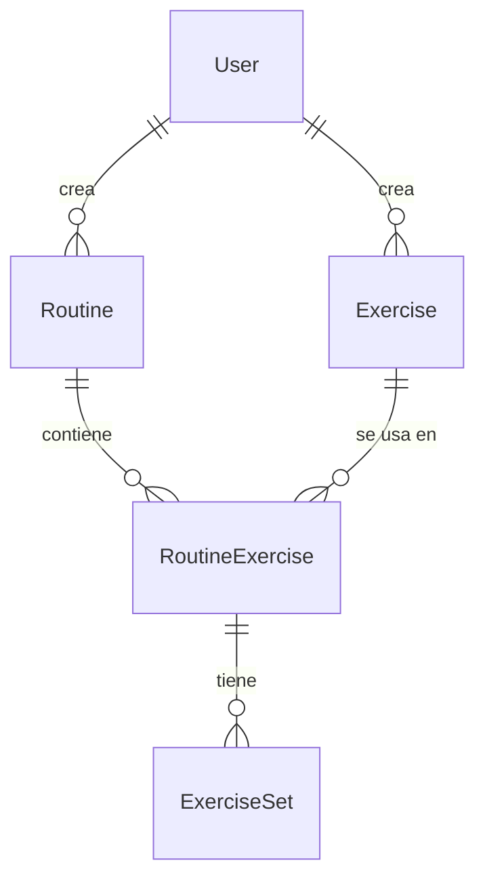

# Propuesta TP DSW — GymRoutines

## Grupo
### Integrantes
* _(legajo)_ - Perroud, Juan Ignacio
* _(legajo)_ - Bruzzesi, Juan José

_(Completar los legajos y verificar los nombres.)_

### Repositorios
* Monorepo fullstack (frontend + backend): <https://github.com/JuanPerroud/tpDSW>

## Tema
### Descripción
GymRoutines es una aplicación web para crear y gestionar rutinas de gimnasio. Los usuarios arman su catálogo de ejercicios, diseñan rutinas con series, repeticiones, peso y descanso, y descubren y guardan rutinas creadas por la comunidad. Un asistente de IA (Gemini) puede sugerir rutinas. Los administradores moderan usuarios y mantienen el catálogo global de ejercicios.

### Modelo
Ver el [diagrama entidad-relación](arquitectura.md#modelo-de-datos) (Mermaid) en la documentación de arquitectura.

### Tecnologías
Node.js + Express 5 + Sequelize + MySQL (backend, JavaScript) · React 19 + Vite + Bootstrap 5 (frontend, JavaScript) · JWT · Jest/Supertest · Vitest/Testing Library · Playwright.

## Alcance Funcional

### Alcance Mínimo

Regularidad:
|Req|Detalle|
|:-|:-|
|CRUD simple|1. CRUD Usuario (registro, perfil, gestión por admin) 2. CRUD Ejercicio (catálogo global y ejercicios privados)|
|CRUD dependiente|1. CRUD Rutina {depende de} Usuario (dueño) y Ejercicio (con sus series)|
|Listado + detalle|1. Listado de ejercicios filtrado por grupo muscular, muestra nombre, grupo y tipo (global/privado) => edición del ejercicio 2. Listado de rutinas de la comunidad filtrado por grupo muscular => detalle (request al backend) con la rutina, sus ejercicios, series y el creador|
|CUU/Epic|1. Armar una rutina: seleccionar ejercicios del catálogo, ordenarlos y definir series, repeticiones, peso y descanso 2. Guardar una rutina de la comunidad en las rutinas propias|

Adicionales para Aprobación
|Req|Detalle|
|:-|:-|
|CRUD|1. CRUD Usuario 2. CRUD Ejercicio 3. CRUD Rutina (incluye RoutineExercise y ExerciseSet como parte de la rutina)|
|CUU/Epic|1. Armar una rutina 2. Guardar una rutina de la comunidad (usa como entrada la data registrada por el caso 1) 3. Gestionar usuarios (admin): buscar, activar/desactivar y eliminar |

### Alcance Adicional Voluntario
|Req|Detalle|
|:-|:-|
|CUU/Epic|1. Sugerir una rutina con IA (Gemini) en un chat dentro del formulario de rutina|
|Otros|1. Login con JWT y dos niveles de acceso (usuario/admin) con rutas protegidas 2. Documentación de la API con Swagger 3. Cuentas desactivables por el administrador (efecto inmediato sobre el token)|
